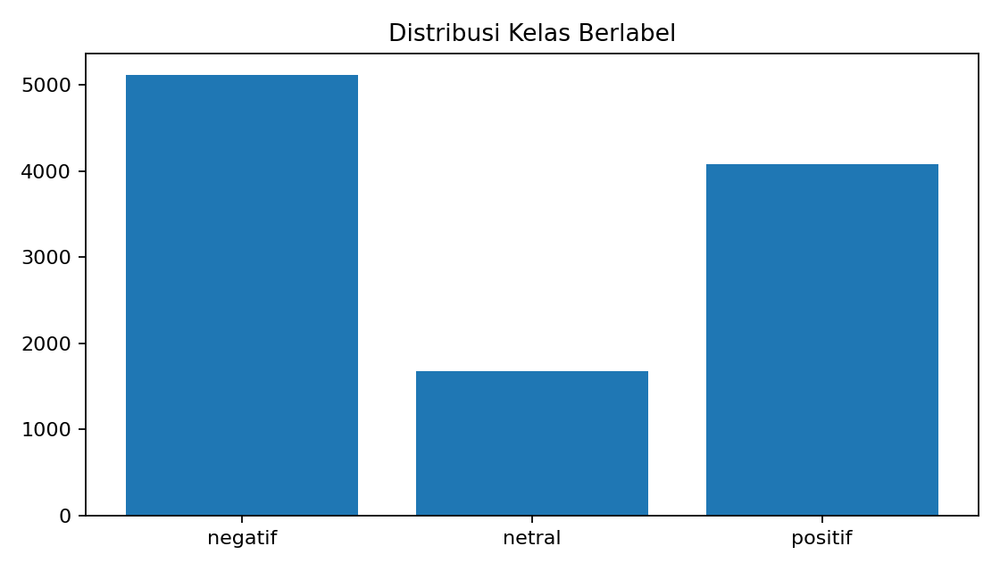
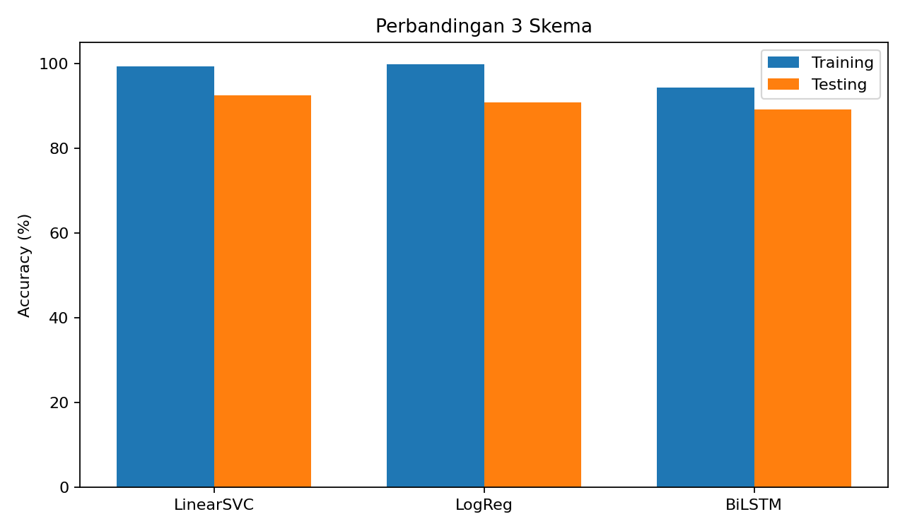

# Analisis Sentimen Ulasan Gojek 🇮🇩

[](https://www.python.org/)
[](https://scikit-learn.org/)
[](https://pytorch.org/)

## Deskripsi proyek

Proyek ini mengembangkan sistem **analisis sentimen ulasan aplikasi Gojek** di Google Play Store sebagai implementasi pembelajaran pada kelas **Belajar Fundamental Deep Learning — Submission 1: Proyek Analisis Sentimen** (Dicoding). Klasifikasi dilakukan terhadap tiga kategori sentimen: **positif, netral, dan negatif**.

Rangkaian eksperimen mencakup pengumpulan data, preprocessing teks bahasa Indonesia, pelabelan otomatis berbasis leksikon, pelatihan tiga skema klasifikasi, evaluasi, serta inferensi menggunakan model terlatih. Dataset, notebook dengan output eksekusi, skrip, model, dan artefak evaluasi disertakan untuk mendukung penelusuran hasil.

> **Catatan implementasi:** Versi repository ini menggunakan **PyTorch** untuk Bidirectional LSTM dan pipeline preprocessing yang dapat berjalan offline. Eksperimen sebelumnya menggunakan TensorFlow/Keras, NLTK, dan PySastrawi. Perubahan framework serta preprocessing menghasilkan eksperimen yang berbeda; metrik keduanya **tidak dapat dianggap sebagai hasil reproduksi yang identik**. Penjelasan tersedia di [METODOLOGI.md](docs/METODOLOGI.md).

## Tujuan

- Mengumpulkan dan mengolah ulasan Gojek berbahasa Indonesia dari Google Play Store.
- Menyiapkan dataset dengan tiga label sentimen serta mengendalikan duplikasi sebelum pembagian data.
- Membandingkan LinearSVC, Logistic Regression, dan Bidirectional LSTM melalui akurasi, macro F1-score, serta confusion matrix.
- Melakukan prediksi sentimen pada ulasan baru menggunakan model yang telah disimpan.

## Dataset

Dataset bersumber dari snapshot **15.000 ulasan** aplikasi Gojek (`com.gojek.app`) dengan kolom `content`, `score`, `at`, dan `thumbsUpCount`. Setelah pembersihan, normalisasi, penghapusan data kosong, dan deduplikasi pada hasil preprocessing, diperoleh **10.863 teks unik** untuk eksperimen.

| Kelas sentimen | Jumlah | Proporsi |
|---|---:|---:|
| Negatif | 5.110 | 47,04% |
| Positif | 4.074 | 37,50% |
| Netral | 1.679 | 15,46% |
| **Total** | **10.863** | **100%** |

Label sentimen dihasilkan dari `data/lexicons/lexicon_positive.csv` dan `data/lexicons/lexicon_negative.csv` menggunakan aturan skor polaritas dan penanganan negasi sederhana. Seluruh label bersifat **pseudo-label**, bukan anotasi manual yang telah divalidasi secara independen. Oleh sebab itu, akurasi model menunjukkan kesesuaian prediksi terhadap pseudo-label, bukan tolok ukur langsung kesesuaian dengan penilaian sentimen manusia.



Detail sumber, rentang tanggal, dan pembuatan dataset berlabel tersedia pada [DATASET.md](docs/DATASET.md).

## Alur pengerjaan

1. **Pengumpulan data:** scraping ulasan dengan `google-play-scraper` dan penyimpanan snapshot CSV.
2. **Preprocessing:** cleaning, case folding, normalisasi kata tidak baku, stopword filtering, dan stemming ringan.
3. **Deduplikasi:** penghapusan nilai `text_stem` identik sebelum pembagian data.
4. **Pelabelan:** penghitungan skor leksikon berbobot dan pemetaan ke tiga kelas.
5. **Pemodelan:** pelatihan tiga skema dengan representasi dan rasio pembagian data berbeda.
6. **Evaluasi dan inferensi:** penghitungan metrik, visualisasi performa, dan uji prediksi pada kalimat baru.

### Konfigurasi eksperimen

| Skema | Algoritma | Representasi teks | Pembagian data |
|---|---|---|---|
| 1 | LinearSVC (L1) | TF-IDF unigram/bigram | 80% latih, 20% uji |
| 2 | Logistic Regression (L2) | Bag-of-Words unigram/bigram | 70% latih, 30% uji |
| 3 | Bidirectional LSTM (PyTorch) | Word embedding | 80% latih, 20% uji; 10% bagian latih untuk validasi |

Proses *fit* vectorizer dan vocabulary dibatasi pada data pelatihan. Pemilihan bobot BiLSTM menggunakan performa data validasi, sedangkan data uji digunakan untuk evaluasi akhir.

## Hasil eksperimen

Hasil berikut berasal dari output eksekusi yang tersimpan dalam `notebook.ipynb` serta laporan [`results/metrics/hasil_evaluasi_final.json`](results/metrics/hasil_evaluasi_final.json).

| Model | Akurasi latih | Akurasi uji | Macro F1 uji |
|---|---:|---:|---:|
| **LinearSVC + TF-IDF** | **99,25%** | **92,50%** | **0,9052** |
| Logistic Regression + BoW | 99,78% | 90,76% | 0,8857 |
| Bidirectional LSTM + Embedding | 94,23% | 89,09% | 0,8717 |



**LinearSVC + TF-IDF** mencapai akurasi uji tertinggi sebesar **92,50%**. Seluruh skema memperoleh akurasi uji lebih dari 85%, tetapi **dua skema belum mencapai 92%** pada data uji. Hasil ini tidak dapat digunakan sebagai jaminan kelulusan atau perolehan tingkat penilaian tertentu dari Dicoding.

Confusion matrix, distribusi kelas, dan kurva pelatihan tersedia di direktori [`results/figures/`](results/figures/). Hasil evaluasi terstruktur dan contoh inferensi disimpan di [`results/metrics/`](results/metrics/).

## Instalasi dan penggunaan

**Persyaratan:** Python 3.10+; eksekusi pada CPU didukung, sedangkan GPU bersifat opsional.

```bash
git clone https://github.com/mpnabil95/analisis-sentimen-ulasan-gojek.git
cd analisis-sentimen-ulasan-gojek
python -m venv .venv
```

Aktivasi virtual environment:

```bash
# Linux / macOS
source .venv/bin/activate

# Windows PowerShell
.venv\Scripts\Activate.ps1
```

Instal dependensi:

```bash
python -m pip install -r requirements.txt
```

**Menjalankan ulang eksperimen:**

```bash
python -m src.train_models
```

Notebook [`notebooks/notebook.ipynb`](notebooks/notebook.ipynb) juga dapat dibuka dengan Jupyter Notebook atau JupyterLab dari root repository atau folder `notebooks/`, lalu dijalankan melalui **Run All**. Hasil dapat sedikit berbeda akibat versi dependensi, perangkat keras, dan proses optimisasi pelatihan.

> **Catatan dataset:** `src/scraping_gojek.py` mengambil ulasan terkini dan dapat menimpa `data/raw/ulasan_gojek_raw.csv`. Untuk mereproduksi hasil yang didokumentasikan, gunakan snapshot CSV yang sudah disertakan tanpa melakukan scraping ulang.

### Inferensi dari model tersimpan

```bash
python -m src.inference "Gojek sangat membantu, driver ramah dan cepat"
python -m src.inference "Aplikasi sering error dan pesanan batal"
```

Perintah tersebut memuat artefak model dari direktori `models/` dan menampilkan prediksi tiga model serta keputusan *majority voting*. Contoh enam prediksi tersedia pada [`results/metrics/contoh_inference.csv`](results/metrics/contoh_inference.csv).

### Pengujian

```bash
python -m pytest tests -q
```

## Struktur repository

Beranda GitHub sengaja dibuat ringkas. Dokumentasi utama dan file konfigurasi tetap berada di root, sementara berkas lain dikelompokkan berdasarkan fungsinya.

```text
analisis-sentimen-ulasan-gojek/
├── README.md                         # Ringkasan proyek dan cara menjalankan
├── requirements.txt                  # Dependensi Python
├── .gitignore                        # File lokal yang tidak diikutsertakan
├── notebooks/
│   └── notebook.ipynb                # Eksperimen lengkap beserta output
├── data/
│   ├── raw/ulasan_gojek_raw.csv       # Dataset awal (15.000 ulasan)
│   ├── processed/ulasan_gojek_labeled.csv
│   └── lexicons/                    # Kamus sentimen positif dan negatif
├── src/                             # Preprocessing, training, inferensi, scraping, audit
├── models/                          # Model terlatih dan vocabulary
├── results/
│   ├── figures/                     # Grafik dan confusion matrix
│   └── metrics/                     # Hasil evaluasi dan contoh inferensi
├── docs/                            # Metodologi, dataset, status submission, panduan
└── tests/                           # Pengujian otomatis
```

Dokumentasi lebih lengkap: [Dataset](docs/DATASET.md) · [Metodologi](docs/METODOLOGI.md) · [Catatan submission](docs/STATUS_SUBMISSION.md) · [Panduan publikasi](docs/PANDUAN_PUSH_MANUAL.md).

## Keterbatasan dan catatan penggunaan

- Evaluasi didasarkan pada pseudo-label berbasis leksikon, belum pada anotasi manusia yang diverifikasi independen.
- Deduplikasi dilakukan terhadap teks hasil preprocessing yang identik; kesamaan semantik antarulasan belum sepenuhnya dieliminasi.
- Metode berbasis leksikon dan stemming ringan dapat kesulitan menangani sarkasme, campuran sentimen, serta variasi bahasa informal.
- Rating bintang tidak digunakan sebagai label target klasifikasi.
- Ulasan publik tidak otomatis mewakili seluruh populasi pengguna aplikasi.
- File model `joblib` hanya boleh dimuat dari sumber tepercaya.
- Data dan kode digunakan untuk keperluan pembelajaran; penggunaan ulang perlu mempertimbangkan privasi, ketentuan sumber data, dan hak pemilik konten.

Proyek ini tidak berafiliasi secara resmi dengan Gojek maupun Dicoding. **Lisensi open-source belum ditetapkan**; ketersediaan kode dalam repository publik tidak dengan sendirinya memberikan izin penggunaan ulang.
