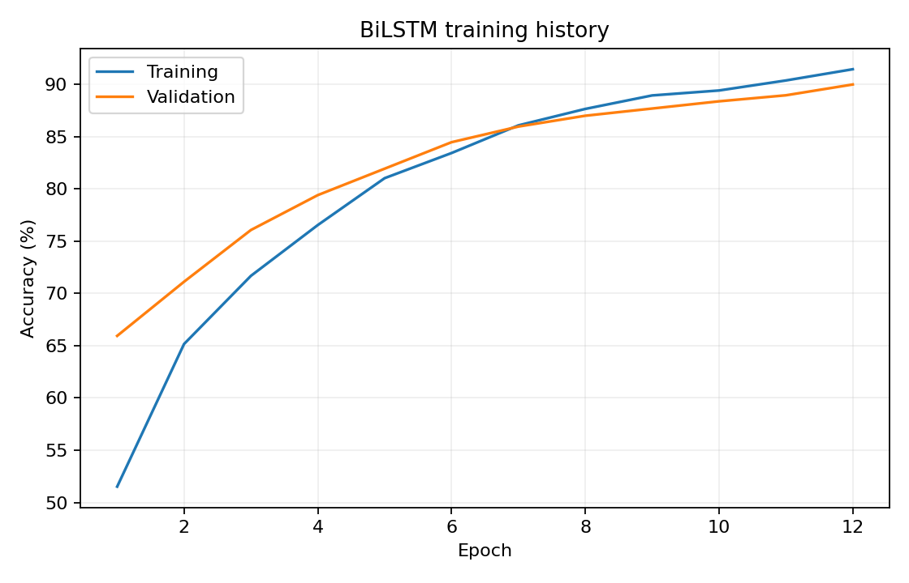
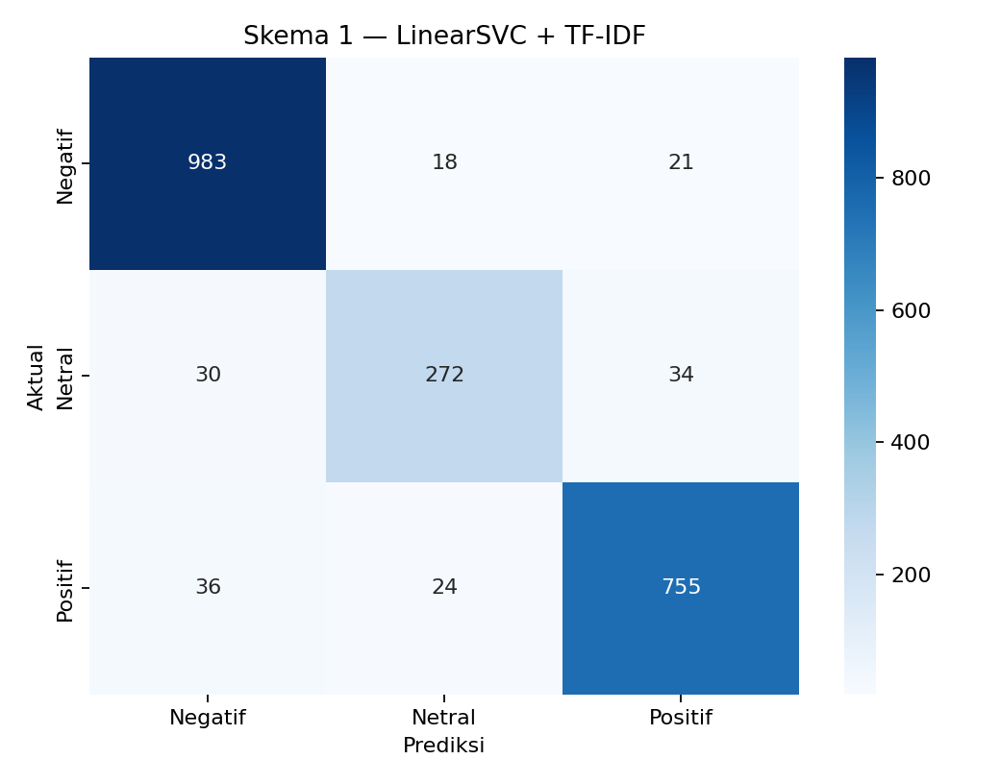
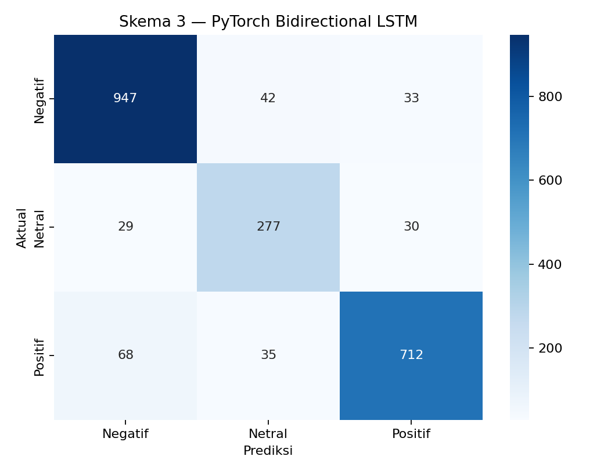
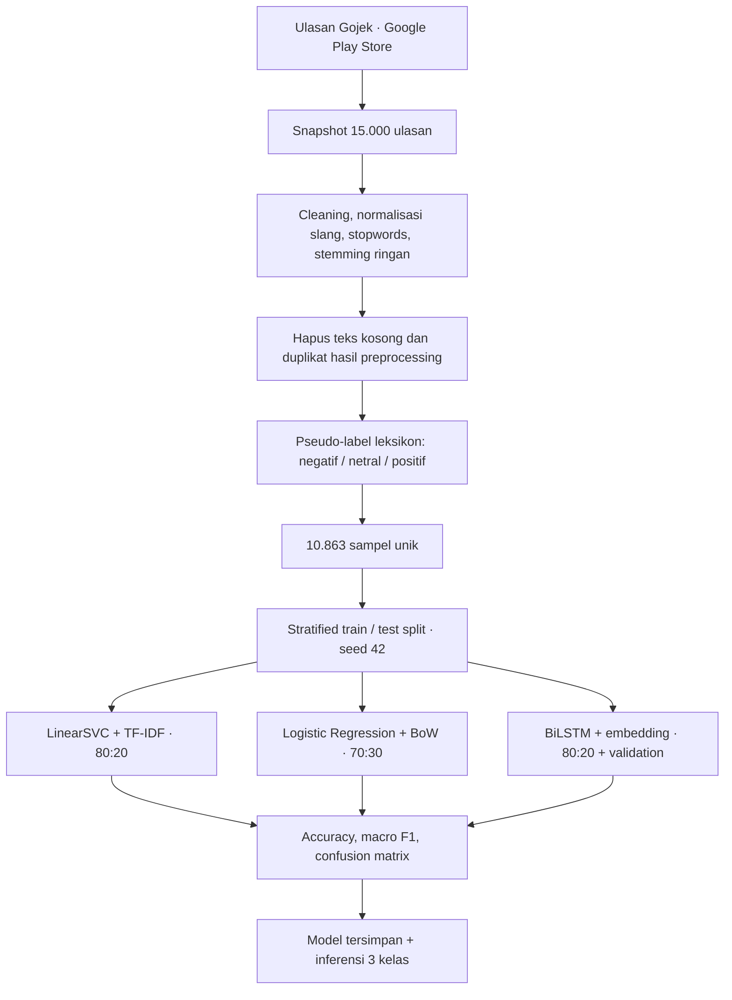

<div align="center">

# Analisis Sentimen Ulasan Gojek

**End-to-end sentiment analysis · Indonesian NLP · Machine Learning & Deep Learning**

[](https://www.python.org/)
[](https://scikit-learn.org/)
[](https://pytorch.org/)
[](#dataset)

Analisis sentimen ulasan aplikasi **Gojek** dari Google Play Store, mulai dari pengumpulan data dan preprocessing teks bahasa Indonesia hingga pelabelan berbasis leksikon, pelatihan tiga model, evaluasi, dan inferensi. Proyek ini dikembangkan dalam konteks **Belajar Fundamental Deep Learning — Submission 1: Proyek Analisis Sentimen** (Dicoding).

[**Buka notebook**](notebooks/notebook.ipynb) · [**Lihat hasil evaluasi**](results/metrics/hasil_evaluasi_final.json) · [**Baca metodologi**](docs/METODOLOGI.md) · [**Dokumentasi dataset**](docs/DATASET.md)


</div>

## Daftar isi

- [Ikhtisar](#ikhtisar)
- [Temuan utama](#temuan-utama)
- [Visualisasi hasil](#visualisasi-hasil)
- [Alur dan metodologi](#alur-dan-metodologi)
- [Dataset](#dataset)
- [Eksperimen dan evaluasi](#eksperimen-dan-evaluasi)
- [Contoh inferensi](#contoh-inferensi)
- [Struktur repository](#struktur-repository)
- [Menjalankan proyek](#menjalankan-proyek)
- [Reproduksibilitas dan pengujian](#reproduksibilitas-dan-pengujian)
- [Keterbatasan](#keterbatasan)
- [Dokumentasi dan atribusi](#dokumentasi-dan-atribusi)

## Ikhtisar

Proyek ini mengeksplorasi klasifikasi opini pengguna aplikasi Gojek ke dalam kategori **negatif**, **netral**, dan **positif**. Tiga pendekatan dibandingkan untuk melihat perbedaan performa pada representasi teks dan algoritma yang berbeda:

1. **LinearSVC + TF-IDF** sebagai model berbasis fitur kata dan n-gram.
2. **Logistic Regression + Bag-of-Words** sebagai pembanding machine learning.
3. **Bidirectional LSTM + word embedding** sebagai pendekatan deep learning menggunakan PyTorch.

Pipeline mencakup dataset dan model terlatih, notebook dengan keluaran eksekusi, evaluasi per kelas, confusion matrix, kurva pelatihan BiLSTM, serta perintah inferensi menggunakan model yang disimpan.

### Ringkasan eksperimen

| Indikator | Hasil |
|---|---:|
| Ulasan mentah | **15.000** |
| Teks unik untuk pemodelan | **10.863** |
| Kelas sentimen | **3** |
| Skema klasifikasi | **3** |
| Akurasi uji tertinggi | **92,50%** |
| Macro F1 model terbaik | **0,9052** |
| Seed eksperimen | `42` |

> **Ruang lingkup metrik:** Seluruh model dievaluasi terhadap **pseudo-label yang dihasilkan oleh leksikon**, bukan label anotasi manusia independen. Angka akurasi tidak dapat langsung ditafsirkan sebagai ketepatan terhadap penilaian sentimen manusia.

## Temuan utama

- **LinearSVC + TF-IDF** menghasilkan akurasi uji tertinggi (**92,50%**) serta *macro F1-score* **0,9052** pada pembagian data 80:20.
- **Logistic Regression + Bag-of-Words** mencapai akurasi uji **90,76%** pada pembagian data 70:30.
- **Bidirectional LSTM (PyTorch)** mencapai akurasi uji **89,09%** dengan validasi terpisah dari data pelatihan. Implementasi deep learning ini tidak melampaui performa LinearSVC pada eksperimen yang dicatat.
- Kelas **netral** menjadi tantangan klasifikasi: F1-score kelas netral pada LinearSVC sekitar **0,8369**, lebih rendah dibandingkan kelas negatif (**0,9493**) dan positif (**0,9292**).
- Seluruh skema melampaui **85% akurasi uji**, tetapi **tidak seluruh skema melampaui 92%**. Pemenuhan ketentuan dan penilaian submission tetap mengikuti keputusan reviewer Dicoding.

Hasil merupakan keluaran eksperimen yang tersimpan dalam [laporan evaluasi JSON](results/metrics/hasil_evaluasi_final.json). Karena skema 2 menggunakan proporsi data uji yang berbeda, selisih akurasi antarskema perlu dibaca sebagai **perbandingan eksperimen**, bukan pembuktian keunggulan algoritma yang terisolasi dari seluruh faktor lain.

## Visualisasi hasil

Visualisasi disimpan sebagai artefak PNG agar hasil dapat ditinjau tanpa menjalankan notebook.

| Distribusi label | Riwayat pelatihan BiLSTM |
|---|---|
|  |  |

**Confusion matrix masing-masing model**

| LinearSVC + TF-IDF | Logistic Regression + BoW | Bidirectional LSTM |
|---|---|---|
|  |  |  |

File visualisasi lainnya tersedia di [`results/figures/`](results/figures/).

## Alur dan metodologi



Tahap preprocessing menggunakan *case folding*, cleaning, normalisasi slang, penyaringan stopword yang mempertahankan beberapa kata negasi, serta **stemming ringan berbasis aturan**. Teks hasil preprocessing (`text_stem`) dideduplikasi sebelum data dibagi menjadi training dan testing. Label ditentukan dari skor kata positif/negatif dan aturan penanganan negasi sederhana:

| Skor polaritas | Label |
|---|---|
| `score > 0` | `positif` |
| `score = 0` | `netral` |
| `score < 0` | `negatif` |

Kamus lokal tersedia di [`data/lexicons/`](data/lexicons/); kode preprocessing dan pelabelan berada di [`src/pipeline_gojek.py`](src/pipeline_gojek.py). **Rating bintang bukan label target** dalam eksperimen ini.

## Dataset

Dataset berasal dari ulasan aplikasi Gojek (`com.gojek.app`) yang diambil melalui `google-play-scraper` dengan pengaturan bahasa dan negara Indonesia. Snapshot mentah memuat ulasan bertanggal **10 Mei–18 Oktober 2026** (rentang tanggal ulasan, bukan waktu scraping).

| File | Isi | Jumlah baris |
|---|---|---:|
| [`data/raw/ulasan_gojek_raw.csv`](data/raw/ulasan_gojek_raw.csv) | Teks ulasan, rating, tanggal, jumlah likes | 15.000 |
| [`data/processed/ulasan_gojek_labeled.csv`](data/processed/ulasan_gojek_labeled.csv) | Teks hasil preprocessing, skor polaritas, pseudo-label | 10.863 |

Kolom pada snapshot mentah: `content`, `score`, `at`, dan `thumbsUpCount`.

### Distribusi sentimen

| Sentimen | Jumlah | Proporsi |
|---|---:|---:|
| Negatif | 5.110 | 47,04% |
| Positif | 4.074 | 37,50% |
| Netral | 1.679 | 15,46% |
| **Total** | **10.863** | **100%** |

Rincian asal data, transformasi, serta perbedaan jumlah sampel antara implementasi terdahulu dan versi ini dijelaskan dalam [`docs/DATASET.md`](docs/DATASET.md).

## Eksperimen dan evaluasi

### Konfigurasi tiga skema

| Skema | Model | Ekstraksi fitur | Pembagian data |
|---|---|---|---|
| 1 | LinearSVC, regularisasi L1 | TF-IDF unigram–bigram | 80% train / 20% test |
| 2 | Logistic Regression, regularisasi L2 | Bag-of-Words unigram–bigram | 70% train / 30% test |
| 3 | Bidirectional LSTM, PyTorch | Vocabulary dan word embedding | 80% train / 20% test; 10% bagian train menjadi validation |

Pada skema 1 dan 2, vectorizer di-*fit* hanya pada training set. Pada skema 3, vocabulary dibangun dari data latih saja; bobot model dipilih berdasarkan performa validation set sebelum evaluasi pada test set.

### Performa model

| Model | Akurasi training | Akurasi testing | Macro F1 testing |
|---|---:|---:|---:|
| **LinearSVC + TF-IDF** | **99,25%** | **92,50%** | **0,9052** |
| Logistic Regression + BoW | 99,78% | 90,76% | 0,8857 |
| Bidirectional LSTM + Embedding | 94,23% | 89,09% | 0,8717 |

**Definisi metrik:**

- **Accuracy:** proporsi prediksi yang sesuai dengan pseudo-label pada subset yang dievaluasi.
- **Macro F1:** rata-rata F1-score ketiga kelas dengan bobot kelas yang sama; berguna untuk menilai performa di luar kelas yang jumlahnya dominan.
- **Confusion matrix:** distribusi jumlah prediksi benar dan salah per kelas.

Hasil terperinci—termasuk *classification report*, ukuran subset, confusion matrix, serta riwayat pelatihan BiLSTM—tersimpan di [`results/metrics/hasil_evaluasi_final.json`](results/metrics/hasil_evaluasi_final.json).

## Contoh inferensi

Model yang telah disimpan menerima kalimat baru dan menghasilkan label `negatif`, `netral`, atau `positif`. Tabel berikut merupakan sebagian dari **enam contoh inferensi tersimpan**, bukan hasil pengujian interaktif baru.

| Ulasan baru | LinearSVC | LogReg | BiLSTM | Voting mayoritas |
|---|---|---|---|---|
| “Aplikasi Gojek sangat bagus, mudah digunakan dan driver ramah” | Positif | Positif | Positif | **Positif** |
| “Aplikasi sering error dan sangat mengecewakan” | Negatif | Negatif | Negatif | **Negatif** |
| “Saya memesan makanan dari restoran dekat kantor” | Netral | Netral | Netral | **Netral** |

Enam hasil lengkap, termasuk teks setelah preprocessing dan skor keyakinan BiLSTM, dapat ditinjau dalam [`results/metrics/contoh_inference.csv`](results/metrics/contoh_inference.csv).

### Prediksi melalui command line

```bash
python -m src.inference "Gojek sangat membantu, driver ramah dan cepat"
```

Skrip memuat dua pipeline scikit-learn serta checkpoint BiLSTM dan vocabulary dari direktori [`models/`](models/), lalu menampilkan prediksi masing-masing model dan hasil *majority voting*.

## Struktur repository

Struktur file dikelompokkan berdasarkan tahap kerja agar direktori utama tetap ringkas.

```text
analisis-sentimen-ulasan-gojek/
├── README.md
├── requirements.txt
├── .gitignore
├── notebooks/
│   └── notebook.ipynb
├── data/
│   ├── raw/                  # Snapshot ulasan hasil scraping
│   ├── processed/            # Dataset hasil preprocessing + pseudo-label
│   └── lexicons/             # Kamus sentimen positif/negatif
├── src/                      # Scraping, preprocessing, training, inferensi, audit
├── models/                   # Model tersimpan dan vocabulary BiLSTM
├── results/
│   ├── figures/              # Grafik evaluasi dan kurva pelatihan
│   └── metrics/              # JSON/CSV evaluasi dan inferensi
├── docs/                     # Metodologi, dataset, audit, dan panduan
└── tests/                    # Pengujian otomatis
```

## Menjalankan proyek

### Prasyarat

- Python **3.10+** dan Git.
- Koneksi internet untuk menginstal dependensi; scraping ulang **tidak diperlukan** untuk memakai snapshot data yang tersedia.
- CPU dapat digunakan untuk pelatihan dan inferensi; pelatihan BiLSTM mungkin membutuhkan waktu lebih lama dibandingkan model machine learning.

### 1. Clone dan siapkan environment

```bash
git clone https://github.com/mpnabil95/analisis-sentimen-ulasan-gojek.git
cd analisis-sentimen-ulasan-gojek
python -m venv .venv
```

Aktifkan virtual environment sesuai sistem operasi.

**Windows PowerShell**

```powershell
.\.venv\Scripts\Activate.ps1
```

**macOS / Linux**

```bash
source .venv/bin/activate
```

Kemudian instal dependensi:

```bash
python -m pip install --upgrade pip
python -m pip install -r requirements.txt
```

### 2. Gunakan model terlatih

```bash
python -m src.inference "Aplikasi sering error dan pesanan batal"
```

### 3. Jalankan pengujian

```bash
python -m pytest tests -q
```

### 4. Latih ulang model (opsional)

```bash
python -m src.train_models
```

Perintah ini menjalankan kembali preprocessing, pelabelan, tiga skema pelatihan, dan penyimpanan hasil. **Artefak di `data/processed/`, `models/`, dan `results/` dapat tertimpa.** Buat salinan terlebih dahulu apabila keluaran lama perlu dipertahankan.

Notebook dengan output tersimpan tersedia di [`notebooks/notebook.ipynb`](notebooks/notebook.ipynb). Untuk mengeksekusinya melalui antarmuka Jupyter, instal Jupyter Notebook/JupyterLab secara terpisah bila belum tersedia pada lingkungan kerja.

## Reproduksibilitas dan pengujian

| Pemeriksaan | Mekanisme |
|---|---|
| Integritas data mentah | Skema empat kolom dan jumlah 15.000 baris diuji pada `tests/` |
| Keunikan data latih | `text_stem` tidak boleh duplikat dan tiga kelas harus tersedia |
| Preprocessing dan negasi | Unit test untuk cleaning, normalisasi, negasi, dan deduplikasi |
| Overlap antar-subset | Pemeriksaan `text_stem` antar training, validation, dan testing saat pipeline dijalankan |
| Laporan eksperimen | Hasil JSON/CSV dan model terlatih disimpan di repository |

Untuk menjalankan audit dataset tanpa melatih ulang model:

```bash
python -m src.audit_dataset_gojek
```

Audit menghasilkan laporan JSON baru di `results/metrics/`. Saat eksekusi ulang, hasil dapat berbeda akibat versi pustaka, perangkat keras, atau dinamika optimisasi. Gunakan **snapshot CSV yang sudah tersedia**, bukan scraping ulang, untuk membandingkan hasil dengan laporan repository.

> **Versi implementasi:** Revisi proyek yang terdokumentasi menggunakan **PyTorch** untuk BiLSTM dan preprocessing offline dengan stemming ringan. Eksperimen sebelumnya menggunakan **TensorFlow/Keras, NLTK, dan PySastrawi**. Keduanya merupakan implementasi berbeda; hasil akurasi tidak boleh digabung atau dianggap reproduksi identik. Detail perubahan tersedia di [`docs/METODOLOGI.md`](docs/METODOLOGI.md).

## Keterbatasan

- **Pseudo-label leksikon** belum divalidasi menggunakan anotasi sentimen manusia independen; angka performa mengukur kecocokan dengan label otomatis.
- Penghapusan duplikat menjamin keunikan teks hasil preprocessing, tetapi tidak menghilangkan seluruh kemiripan semantik.
- Bahasa informal, sarkasme, sentimen campuran, dan pola negasi kompleks masih berpotensi menyebabkan kesalahan klasifikasi.
- Distribusi kelas tidak sepenuhnya seimbang; jumlah contoh netral lebih kecil daripada positif dan negatif.
- Snapshot ulasan publik tidak otomatis mewakili seluruh populasi pengguna aplikasi.
- File model `joblib` hanya boleh dimuat dari sumber tepercaya. Penggunaan ulang data harus memperhatikan privasi dan ketentuan Google Play Store.
- Tidak ada klaim bahwa seluruh target skor submission Dicoding telah terpenuhi atau bahwa hasil ini telah memperoleh penilaian tertentu dari reviewer.

## Dokumentasi dan atribusi

| Referensi | Isi |
|---|---|
| [Notebook](notebooks/notebook.ipynb) | Eksperimen, output, dan visualisasi |
| [Metodologi](docs/METODOLOGI.md) | Teknik preprocessing, pseudo-label, split, dan evaluasi |
| [Dataset](docs/DATASET.md) | Sumber data, rentang tanggal, atribut, dan distribusi label |
| [Panduan struktur](docs/STRUKTUR_PROYEK.md) | Lokasi file dan perintah utama |
| [Catatan submission](docs/STATUS_SUBMISSION.md) | Audit mandiri terhadap saran penilaian Dicoding |
| [Hasil evaluasi](results/metrics/hasil_evaluasi_final.json) | Metrik eksperimen dan laporan per kelas |

**Sumber ulasan:** Google Play Store, aplikasi Gojek (`com.gojek.app`). Proyek bersifat pembelajaran dan **tidak berafiliasi resmi** dengan Gojek maupun Dicoding.

**Lisensi:** Repository saat ini belum menyertakan lisensi open-source. Publikasi kode dan data secara terbuka tidak otomatis memberikan izin penggunaan ulang; hak atas konten ulasan tetap mengikuti ketentuan yang berlaku.
